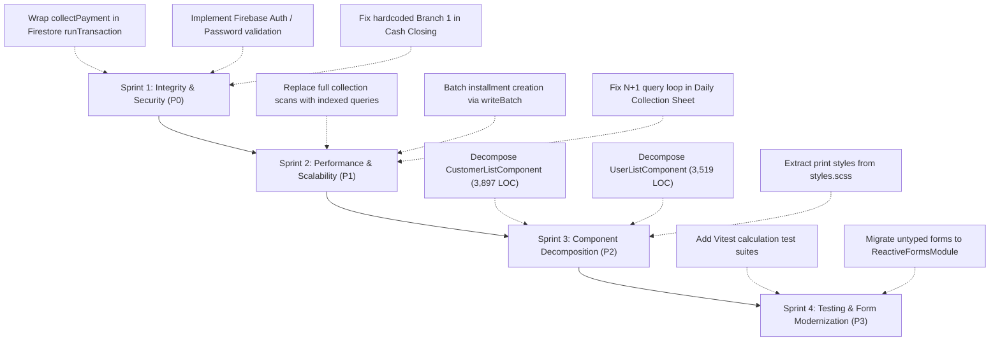

# 🏛️ eKisti (ই-কিস্তি) — Comprehensive Codebase Review & Architectural Audit

**Project:** `eKisti` (Smart Microfinance & Cooperative Management System)  
**Stack:** Angular 21.2.24 (Standalone), TypeScript 5.9, SCSS, Firebase Firestore 12.19, Vitest  
**Audit Date:** October 2026  
**Auditor:** Antigravity AI Engineering Team  

---

## 1. Executive Summary & Quality Scorecard

eKisti exhibits strong domain modeling for Bangladeshi microfinance, a thoughtful UI design system, modern Angular 21 standalone component architecture, and extensive print layout engineering. However, the codebase currently suffers from **critical transactional integrity risks in financial operations**, **a non-authenticating authentication layer**, **severe scalability/N+1 query bottlenecks in Firestore**, and two massive **monolithic "God Components"** spanning several thousand lines of code.

### 📊 Engineering Scorecard

| Domain | Score | Status | Primary Driver |
| :--- | :---: | :---: | :--- |
| **Domain Modeling & UI Design** | **8.5 / 10** | 🟢 Strong | Rich domain schemas, bilingual labels, specialized microfinance print engine |
| **Angular 21 Architecture** | **7.5 / 10** | 🟡 Good | 100% standalone components, extensive Signals usage, lazy loaded routes |
| **Data Integrity & Consistency** | **3.0 / 10** | 🔴 Critical | Non-atomic multi-document writes during collections; missing Firestore transactions |
| **Security & Authentication** | **2.5 / 10** | 🔴 Critical | Login completely ignores passwords; no Firebase Auth token validation; client-side auth |
| **Firestore Query Efficiency** | **3.5 / 10** | 🔴 High Risk | Full-collection scans, client-side filtering, N+1 query loops, no server pagination |
| **Maintainability & Modularity** | **5.0 / 10** | 🟡 Warning | Two components exceed 3,500 LOC; monolithic 1,049-line global stylesheet; untyped forms |
| **Test Coverage & QA** | **1.0 / 10** | 🔴 Failing | Zero feature/service tests; single stale template boilerplate test |

---

## 2. 🔴 Critical Vulnerabilities & Data Integrity Hazards (P0)

### 2.1. Non-Transactional Financial Collection (`collectPayment`)
- **Location:** [`src/app/core/services/kisti-database.service.ts`](file:///c:/unversity/eKisti-app/src/app/core/services/kisti-database.service.ts#L341-L438)
- **Hazard:** `collectPayment()` performs four separate, sequential Firestore writes:
  1. `setDoc()` on `collections/{receiptId}` (receipt creation)
  2. `updateDoc()` on `loans/{loanId}` (updating `totalPaidAmount`, `outstandingBalance`, installment counter)
  3. `updateDoc()` on `customers/{customerId}` (updating savings balance)
  4. `setDoc()` on `savings_transactions/{trxId}` (recording savings ledger)
- **Impact:** If the user loses network connectivity, closes the tab, or encounters a quota limit during step 2 or 3, **money is collected without updating the loan balance or savings account**, or vice versa. In microfinance, this causes catastrophic financial reconciliation errors and audit failures.
- **Remediation:** Wrap all four writes inside a single atomic Firestore transaction (`runTransaction(this.firestore, async (trx) => { ... })`).

### 2.2. Password Disregard & Fake Authentication
- **Location:** [`src/app/core/services/auth-state.service.ts`](file:///c:/unversity/eKisti-app/src/app/core/services/auth-state.service.ts#L384-L398)
- **Hazard:** The `login()` method accepts `(emailOrPhone: string, password?: string)` but **never checks the password**:
  ```typescript
  login(emailOrPhone: string, password?: string): boolean {
    const cleanId = emailOrPhone.trim().toLowerCase();
    const users = this.availableUsers();
    const user = users.find(u => 
      u.email.toLowerCase() === cleanId || 
      u.phone === cleanId ||
      u.name.toLowerCase().includes(cleanId) // Also matches substrings in names!
    );
    if (user) {
      this.setUserSession(user);
      return true;
    }
    return false;
  }
  ```
- **Impact:** Entering any user's email, phone, or even a single letter matching someone's name grants full access to the system without credentials.
- **Remediation:** Integrate `@angular/fire/auth` via `signInWithEmailAndPassword`, store secure Firebase UIDs, and protect Firestore via Firebase Security Rules rather than relying solely on client-side state.

### 2.3. Hardcoded Single Branch in Reconciliation
- **Location:** [`src/app/features/reconciliation/cash-closing/cash-closing.component.ts`](file:///c:/unversity/eKisti-app/src/app/features/reconciliation/cash-closing/cash-closing.component.ts#L36) & [L87](file:///c:/unversity/eKisti-app/src/app/features/reconciliation/cash-closing/cash-closing.component.ts#L87)
- **Hazard:** The component hardcodes branch `'1'`:
  ```typescript
  const branchDocRef = doc(this.firestore, 'branches', '1');
  ```
- **Impact:** Any cashier reconciling cash across branches (e.g. Branch #2, Branch #3) will overwrite the vault cash of Branch #1. This breaks the multi-branch capability.
- **Remediation:** Bind vault updates to `this.authService.currentUser().branchId` dynamically.

---

## 3. 🟠 High-Priority Scalability & Performance Bottlenecks (P1)

### 3.1. Firestore Full-Collection Reads & Client-Side Filtering
- **Locations:**
  - [`kisti-database.service.ts#L328-L331`](file:///c:/unversity/eKisti-app/src/app/core/services/kisti-database.service.ts#L328-L331): `getLoansByCustomerId()` loads **all loans in the database** into memory, then calls `.filter(l => l.customerId === customerId)`.
  - [`kisti-database.service.ts#L87-L96`](file:///c:/unversity/eKisti-app/src/app/core/services/kisti-database.service.ts#L87-L96): `getCustomers()` downloads all customer documents, including soft-deleted ones.
  - [`src/app/features/dashboard/dashboard.component.ts#L44-L100`](file:///c:/unversity/eKisti-app/src/app/features/dashboard/dashboard.component.ts#L44-L100): Fetches every single collection, installment, and loan in Firestore to compute today's metrics client-side.
- **Cost & Speed Impact:** Firestore bills per document read. If the cooperative has 5,000 customers and 3,000 active loans, loading the customer profile will download 3,000 loan documents. A single dashboard refresh consumes 10,000+ reads.
- **Remediation:** Use indexed Firestore queries:
  ```typescript
  query(collection(this.firestore, 'loans'), where('customerId', '==', customerId), where('isDeleted', '==', false))
  ```

### 3.2. Severe N+1 Query Loop in Daily Collection Sheet
- **Location:** [`src/app/features/collections/daily-sheet/daily-sheet.component.ts`](file:///c:/unversity/eKisti-app/src/app/features/collections/daily-sheet/daily-sheet.component.ts#L157-L289)
- **Hazard:** `loadSheetData()` retrieves active loans and executes a separate Firestore query inside a loop for each loan's installments.
- **Impact:** For a samity with 40 members, opening the sheet triggers 40+ concurrent network queries, degrading loading performance and exhausting connection pools on field mobile devices.
- **Remediation:** Batch load active installments for the target samity in a single query using `where('centerId', '==', selectedCenterId)` and `where('status', 'in', ['PENDING', 'PARTIAL'])`.

### 3.3. Sequential ID Generation Overhead in Loan Disbursement
- **Location:** [`src/app/core/services/kisti-database.service.ts#L249-L290`](file:///c:/unversity/eKisti-app/src/app/core/services/kisti-database.service.ts#L249-L290)
- **Hazard:** For a 40-installment loan, `disburseLoan()` executes `getNextIntegerId('installments')` in a loop 40 times. Each ID requires a separate Firestore `runTransaction()` roundtrip (40 transactions) followed by 40 individual `setDoc()` calls.
- **Impact:** Disbursing a single loan requires 80+ network roundtrips, causing noticeable latency (3-6 seconds) and potential transaction contention.
- **Remediation:** Implement batch ID reservation in `CounterService` (`reserveIntegerRange('installments', 40)`) and write all installment documents using a single `writeBatch()`.

---

## 4. 🟡 Architectural & Component Modularity (P2)

### 4.1. Monolithic "God Components"
Two components contain an excessive amount of code and responsibilities:

1. **`CustomerListComponent` (Total: 3,897 Lines)**
   - TypeScript: 733 lines
   - HTML: 972 lines
   - SCSS: 2,192 lines
   - *Issues:* Handles customer table, 6 separate modal dialogs (Passbook, Loan ledger, Savings history, Account closure, Reactivation, Audit history), and direct DOM print classList manipulation.
   - *Action:* Break into modular subcomponents:
     - `CustomerTableComponent`
     - `CustomerPassbookModalComponent`
     - `CustomerClosureModalComponent`
     - `CustomerPrintReportComponent`

2. **`UserListComponent` (Total: 3,519 Lines)**
   - TypeScript: 713 lines
   - HTML: 1,564 lines
   - SCSS: 1,242 lines
   - *Issues:* Combines staff directory, role permission configuration builder, staff creation modal, and ID card printing into one component.
   - *Action:* Split into `StaffDirectoryComponent`, `RolePermissionMatrixComponent`, and `StaffIdCardComponent`.

### 4.2. Global SCSS Monolith (`src/styles.scss` — 1,049 Lines)
- 56% of `styles.scss` (lines 462–1049, ~590 lines) consists of `@media print` rules for customer details, ID cards, and disbursement receipts.
- **Remediation:** Extract print styling into SCSS partials:
  - `src/styles/_variables.scss`
  - `src/styles/_components.scss`
  - `src/styles/_print-engine.scss`

### 4.3. Modern Angular 21 Idioms & Signal Optimization
- **`CommonModule` cleanup:** Multiple standalone components import `CommonModule` despite using Angular 21's `@if` and `@for` control flow.
- **Signal Inputs/Outputs:** [`src/app/shared/components/history-modal/history-modal.component.ts`](file:///c:/unversity/eKisti-app/src/app/shared/components/history-modal/history-modal.component.ts) still uses legacy `@Input()` and `@Output()` decorators instead of `input()` and `output()`.
- **Computed signals vs Template methods:** Methods like `filteredCustomers()`, `filteredLoans()`, and `isLockedByWeeklyRule()` are called directly inside templates, causing recalculations on every change detection pass. Convert them to `computed()` signals.

### 4.4. Untyped Template-Driven Forms
- The entire application uses `FormsModule` and `[(ngModel)]` with loose objects:
  - [`CustomerFormComponent#L50`](file:///c:/unversity/eKisti-app/src/app/features/customers/customer-form/customer-form.component.ts#L50): `customer: any = { ... }`
  - [`UserListComponent#L81`](file:///c:/unversity/eKisti-app/src/app/features/users/user-list/user-list.component.ts#L81): `editForm: any = { ... }`
- **Impact:** Zero compile-time type validation for KYC, address subfields, or guarantor data. Typos in form field names fail silently at runtime.
- **Remediation:** Introduce Angular `ReactiveFormsModule` with typed `FormGroup<CustomerForm>`.

---

## 5. 🔒 Security, Routing & Authorization Review

| Route | Current Guard | Required Protection | Risk Level |
| :--- | :--- | :--- | :---: |
| `/dashboard` | `[authGuard]` | Any authenticated staff | 🟢 Low |
| `/loans/disburse` | `[authGuard]` | **Branch Manager, Super Admin, Area Manager** | 🔴 High (FO can open URL) |
| `/reconciliation` | `[authGuard]` | **Cashier, Branch Manager, Super Admin** | 🔴 High (FO can open URL) |
| `/users` | `[authGuard, superAdminGuard]` | Super Admin Only | 🟢 Protected |
| `/collections` | `[authGuard]` | Needs redirect to `/collections/daily` | 🟡 UX Bug (shows blank page) |
| `/customers/new` vs `/register`| `[authGuard]` | Duplicate routes loading identical component | 🟡 Redundant |

### Key Authorization Findings:
1. **Missing RBAC Route Guards:** Microfinance permissions (`canDisburseLoan`, `canVerifyCash`) are defined in `auth-state.service.ts` but are **never applied as route guards**. A field officer can manually navigate to `/loans/disburse` and submit loan distributions.
2. **Blocking Native `alert()` in Guards:** [`auth.guard.ts#L25`](file:///c:/unversity/eKisti-app/src/app/core/guards/auth.guard.ts#L25) calls `alert(...)`, which blocks browser rendering and violates modern SPA standards.

---

## 6. 🧹 Code Smells, Type Safety & Dead Code

1. **Weakened Role Union Type:**
   - [`database.models.ts#L93`](file:///c:/unversity/eKisti-app/src/app/core/models/database.models.ts#L93):
     ```typescript
     export type StaffRole = 'SUPER_ADMIN' | 'ADMIN' | ... | 'AUDITOR' | string;
     ```
     Appending `| string` weakens TypeScript type narrowing, effectively turning `StaffRole` into `string`.
2. **Dead Component Import in Receipts:**
   - [`receipt-list.component.ts#L7`](file:///c:/unversity/eKisti-app/src/app/features/collections/receipt-list/receipt-list.component.ts#L7) imports `HistoryModalComponent`, but forgot to add it to `@Component({ imports: [...] })`.
3. **Hardcoded User IDs:**
   - [`customer-list.component.ts#L152-L156`](file:///c:/unversity/eKisti-app/src/app/features/customers/customer-list/customer-list.component.ts#L152-L156): Hardcodes `userId === 502 ? 'মোঃ রফিকুল ইসলাম' : ...`.
4. **Direct DOM ClassList Manipulation:**
   - Printing triggers `document.body.classList.add('print-customer-details')` instead of relying on Angular-managed state or CSS media query triggers.
5. **Shallow Copy in Audit Trail:**
   - [`audit-history.service.ts#L26-L28`](file:///c:/unversity/eKisti-app/src/app/core/services/audit-history.service.ts#L26-L28) uses `{ ...params.previousData }`. Sub-objects like `presentAddress` and `primaryGuarantor` remain object references and can be mutated post-snapshot. Use `structuredClone()`.

---

## 7. 🧪 Testing & Verification Status

- **Existing Unit Tests:** Exactly 1 test file exists: [`src/app/app.spec.ts`](file:///c:/unversity/eKisti-app/src/app/app.spec.ts) (24 LOC).
- **Test Integrity:** The test checks for `'Hello, eKisti-app'`, which fails because the app title and layout have evolved.
- **Feature & Calculation Coverage:** **0%**.
  - Installment math (`effectiveProfitRate`, flat/declining profit, weekly frequency) is untested.
  - Multi-document collection routines are untested.
  - Atomic counter generation has no concurrency tests.

---

## 8. 🗺️ Actionable Modernization Roadmap



### Sprint 1: Security & Financial Data Integrity (Immediate)
- [ ] Refactor [`KistiDatabaseService.collectPayment()`](file:///c:/unversity/eKisti-app/src/app/core/services/kisti-database.service.ts) to execute all ledger, savings, and receipt writes in a single Firestore `runTransaction()`.
- [ ] Connect `AuthStateService` to `@angular/fire/auth` or enforce secure password hashing/verification.
- [ ] Add role-based `CanActivateFn` guards to `/loans/disburse` (`canDisburseLoanGuard`) and `/reconciliation` (`canVerifyCashGuard`).
- [ ] Replace hardcoded branch `'1'` in `CashClosingComponent` with dynamic active branch resolution.

### Sprint 2: Performance & Query Optimization
- [ ] Add `where('customerId', '==', id)` and `where('isDeleted', '==', false)` to loan and customer queries.
- [ ] Add range reservation `reserveIntegerRange()` to `CounterService` and use `writeBatch()` for installment generation in `disburseLoan()`.
- [ ] Batch query daily collection installments by `centerId` to eliminate the N+1 loop in `DailySheetComponent`.
- [ ] Add route redirect for `/collections` -> `/collections/daily`.

### Sprint 3: Component Refactoring & Style Modularization
- [ ] Extract `CustomerPassbookModal`, `CustomerClosureModal`, and `CustomerPrintView` out of `CustomerListComponent`.
- [ ] Split `UserListComponent` into `StaffDirectoryComponent` and `RolePermissionMatrixComponent`.
- [ ] Move print styles into `src/styles/_print.scss`.
- [ ] Replace template methods with `computed()` signals to eliminate change-detection re-computations.

### Sprint 4: Testing & Typing Enhancements
- [ ] Create Vitest test suite for loan disbursement calculations (`loan-disburse.calculator.spec.ts`).
- [ ] Add unit tests for atomic counter sequencing and transaction rollback scenarios.
- [ ] Replace `customer: any` and untyped models with strongly-typed Reactive Forms (`FormGroup`).
- [ ] Remove `| string` from `StaffRole` union type in `database.models.ts`.
